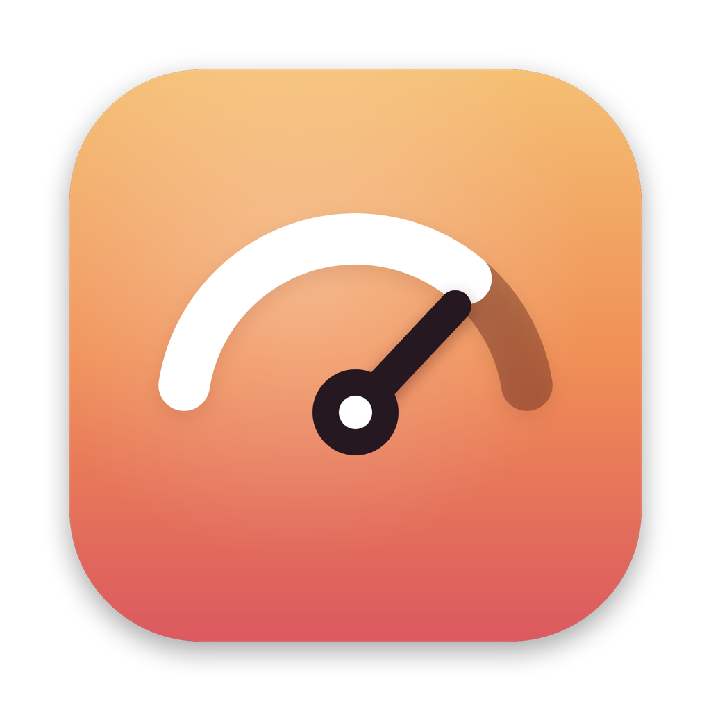
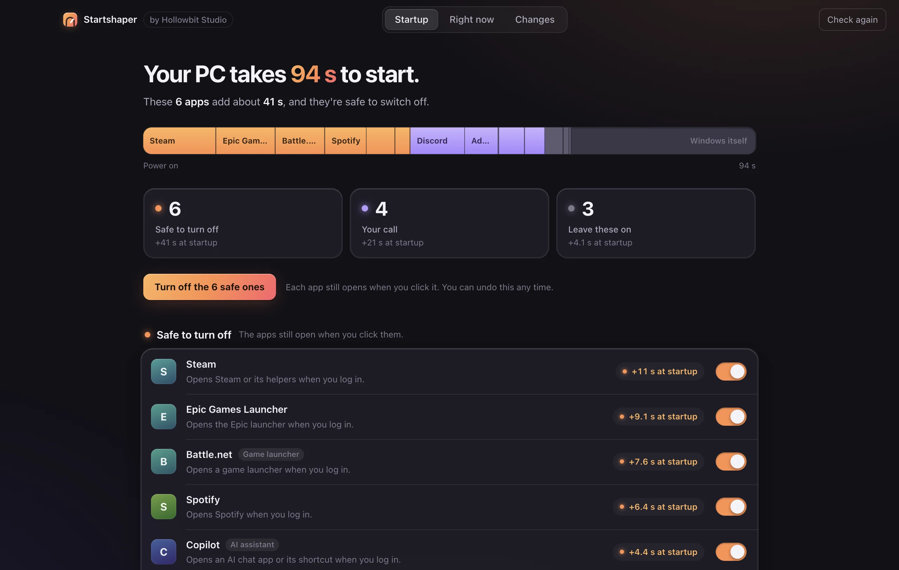

<p align="center">
  <a href="https://hollowbit.dev/startshaper/"></a>
</p>

<h1 align="center">Startshaper</h1>

<p align="center"><b>Why is my PC slow?</b></p>
<p align="center">See every app that starts by itself, what it is in plain words, and switch off the ones you don't need. Every change can be undone.</p>

<p align="center">
  <a href="https://github.com/hollowbit-dev/startshaper/releases/latest"></a>
  
  
  <a href="LICENSE"></a>
</p>

<p align="center">
  <a href="https://hollowbit.dev/startshaper/"></a>
</p>

<p align="center"></p>

## What it does

Startshaper sorts everything that starts by itself into three groups:

- **Safe to turn off:** game launchers, updaters, music and chat apps that open at login. The apps still open when you click them.
- **Your call:** cloud sync, chat apps, Adobe and graphics card helpers. Fine to switch off if you don't need them the moment you log in.
- **Leave these on:** antivirus, drivers, keyboard and mouse tools that only work while they run.

On **Windows** it reads Windows' own startup timing log, so it can tell you *"Your PC takes 94 s to start. These 6 apps add 41 s."* (run it as administrator to see this). On a **Mac** it reads the same list as System Settings → Login Items, including the background helpers that list hides.


**Right now** shows which apps are using the most memory and processor, grouped by app instead of hundreds of processes. **Changes** lists everything you switched off, with one click to turn it all back on.


## Safe by design

- Nothing is ever deleted. Switching an item off uses the same setting as Task Manager's Startup tab on Windows, or `launchctl disable` on a Mac, which is what Login Items uses. Turning it back on puts it exactly how it was.
- No registry tweaks, no "debloat" scripts, no services stopped.
- Items that need an admin password open the system's own screen (Task Manager or Login Items) instead.

## Privacy

The only network request is a once-a-day check of GitHub for a newer version number, which you can turn off on the start screen. Nothing about you or your computer is sent. No account, no ads, no analytics.

> Windows builds have not been tried on a real PC yet. If something breaks, please [open an issue](https://github.com/hollowbit-dev/startshaper/issues/new).

## Install

Get the installer from the [website](https://hollowbit.dev/startshaper/) or the [latest release](https://github.com/hollowbit-dev/startshaper/releases/latest).

- **Mac:** open the .dmg and drag Startshaper to Applications. The first time, right-click it and choose **Open**, because the app isn't signed yet.
- **Windows:** run the installer. If SmartScreen appears, click **More info**, then **Run anyway**.

With Homebrew:

```sh
brew tap hollowbit-dev/tap
brew trust hollowbit-dev/tap
brew install --cask startshaper
```

## Build from source

```
npm install
npm start          # run
npm run demo       # made-up data for screenshots
npm run scan       # print what this Mac starts (read only)
npm test           # Windows parser with fake data, screenshots, packaged app
npm run dist       # installers in dist/
```

## More free apps from Hollowbit

- **[Melodyshaper](https://hollowbit.dev/melodyshaper/)**: hum a tune, make a song
- **[Clipshaper](https://hollowbit.dev/clipshaper/)**: long videos to short clips
- **[Captionshaper](https://hollowbit.dev/captionshaper/)**: offline auto subtitles
- **[Lightshaper](https://hollowbit.dev/lightshaper/)**: free photo editor
- **[Fileshaper](https://hollowbit.dev/fileshaper/)**: compress, convert, sign PDFs
- **[Writeshaper](https://hollowbit.dev/writeshaper/)**: offline writing assistant
- **[Moveshaper](https://hollowbit.dev/moveshaper/)**: move to a new computer
- **[Diskshaper](https://hollowbit.dev/diskshaper/)**: clean up storage
- **[Fuseduo](https://fuseduo.com/)**: automate your Mac apps

## Licence

MIT.

---

<p align="center"><sub>Made by <a href="https://hollowbit.dev">Hollowbit Studio</a>. If Startshaper helped you, a ⭐ helps other people find it.</sub></p>
