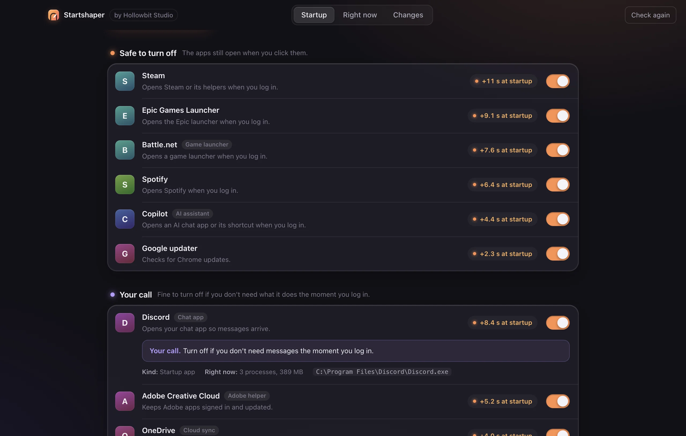
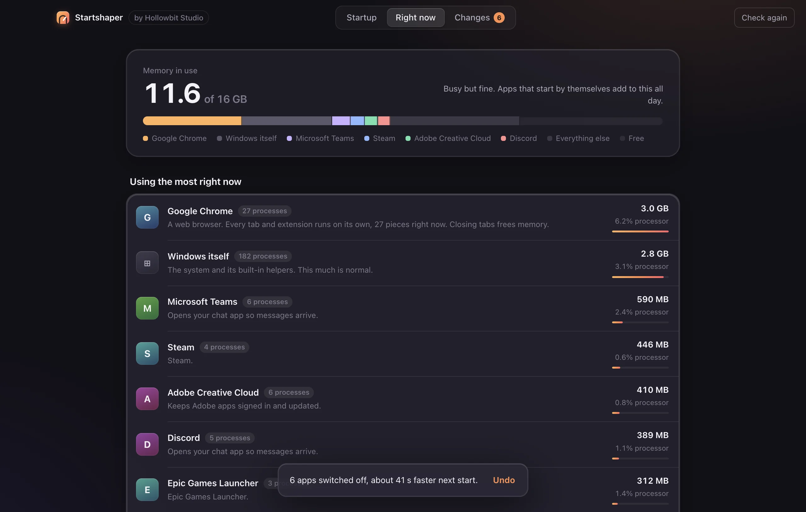

# Startshaper

Why is my PC slow? Startshaper shows every app that starts by itself, says in plain words what each one is, and lets you switch off the ones you don't need. A free app for Windows and Mac by [Hollowbit Studio](https://hollowbit.dev).

**[Download](https://github.com/hollowbit-dev/startshaper/releases/latest)** · [Website](https://hollowbit.dev/startshaper/)


Startshaper sorts everything that starts by itself into three groups:

- **Safe to turn off:** game launchers, updaters, music and chat apps that open at login. The apps still open when you click them.
- **Your call:** cloud sync, chat apps, Adobe and graphics card helpers. Fine to switch off if you don't need them the moment you log in.
- **Leave these on:** antivirus, drivers, keyboard and mouse tools that only work while they run.

On **Windows** it reads Windows' own startup timing log, so it can tell you *"Your PC takes 94 s to start. These 6 apps add 41 s."* (run it as administrator to see this). On a **Mac** it reads the same list as System Settings → Login Items, including the background helpers that list hides.



**Right now** shows which apps are using the most memory and processor, grouped by app instead of hundreds of processes. **Changes** lists everything you switched off, with one click to turn it all back on.



## Safe by design

- Nothing is ever deleted. Switching an item off uses the same setting as Task Manager's Startup tab on Windows, or `launchctl disable` on a Mac, which is what Login Items uses. Turning it back on puts it exactly how it was.
- No registry tweaks, no "debloat" scripts, no services stopped.
- Items that need an admin password open the system's own screen (Task Manager or Login Items) instead.

## Privacy

The only network request is a once-a-day check of GitHub for a newer version number, which you can turn off on the start screen. Nothing about you or your computer is sent. No account, no ads, no analytics.

## Install

- **Mac:** open the .dmg, drag Startshaper to Applications, then right-click it and choose Open the first time (the app isn't signed yet).
- **Windows:** run the installer. If SmartScreen appears, click *More info*, then *Run anyway*.

## Build from source

```
npm install
npm start          # run
npm run demo       # made-up data for screenshots
npm run scan       # print what this Mac starts (read only)
npm test           # Windows parser with fake data, screenshots, packaged app
npm run dist       # installers in dist/
```

MIT licence. Made by Hollowbit Studio, https://hollowbit.dev
